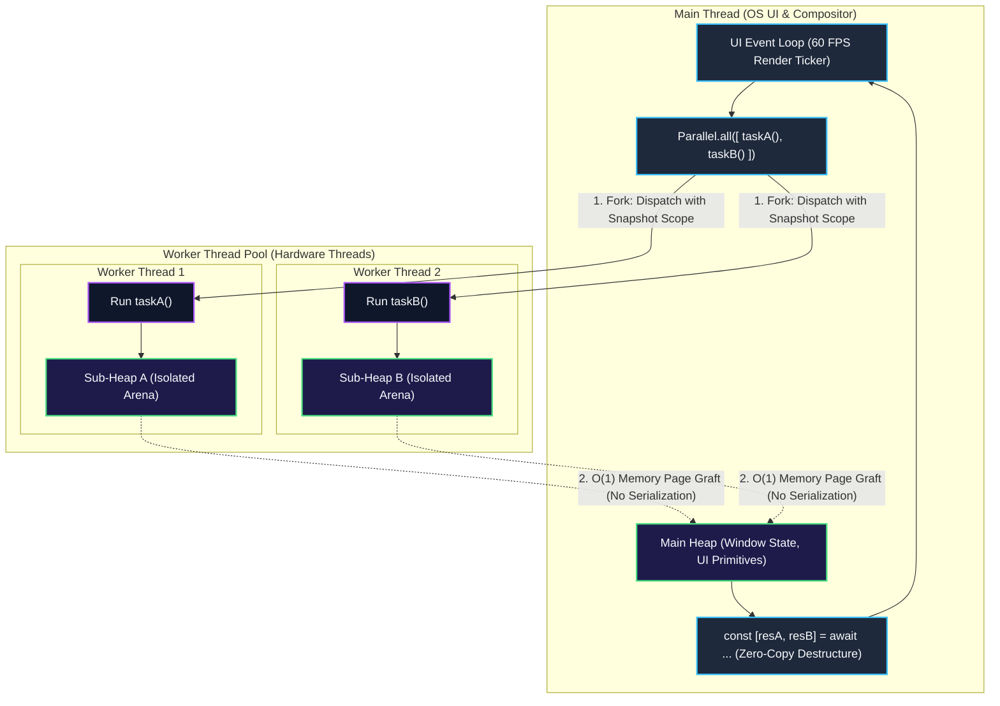

# Multi-Threaded Sub-Heap JS/TS Runtime Specification (`nix.js`)
**Target Architecture:** Rust-based 'Nix OS UI & Compositor Layer  
**Core Innovation:** Dual-Track Concurrency — Cooperative I/O (`Promise.all`) + Multicore Sub-Heaps (`Parallel.all`) with $O(1)$ Zero-Copy Memory Grafting  
**Native Dialect:** First-Class TypeScript (Zero Build Step, Zero NPM)  

---

## 1. Vision & Fundamental Rules

This runtime is not built for web browsers, nor is it a Node.js clone. It is a **lean, purpose-built systems scripting engine** that executes native TypeScript and JavaScript as the developer-facing interface for a custom Rust-based operating system shell.

### Non-Negotiable Tenets
1. **NO NPM, NO `node_modules`:** Zero third-party package ecosystem bloat. If external packages are needed, they are vendored directly from source via git.
2. **First-Class Native TypeScript:** Developers write `.ts` source code directly. The OS loads it natively with zero build steps, zero `tsc`, zero Babel, and zero `tsconfig.json` ceremonies.
3. **OS-Native Standard Library:** All system capabilities (`OS.Window`, `OS.FileSystem`, `OS.Compositor`, `OS.Network`) are exposed via zero-cost Rust FFI.
4. **No Legacy ECMAScript Quirks:** Run-to-completion and live-binding mutable closures across concurrent boundaries are discarded in favor of memory safety and hardware parallelism.
5. **Frame-Independent UI:** Heavy compute or GC activity on worker tasks must never cause frame drops or input stutter on the main UI/compositor thread.

---

## 2. Native TypeScript Ingestion Pipeline

Instead of running an external compiler or slow JS transpiler, `nix.js` handles TypeScript via a pure-Rust pipeline integrated directly into the binary:

```
  [ app.ts ]  (Native TypeScript file, zero build step)
       │
       ▼
  oxc_parser / oxc_transformer (Pure Rust, sub-millisecond in-memory pipeline)
       │
       ├── Phase 1: Fast Type-Stripping -> Emits clean AST / Bytecode
       └── Phase 2: Concrete Interface Extraction -> Emits Fixed-Layout Struct Metadata
       │
       ▼
  Register Bytecode VM + Sub-Heap Allocator
       │
       ▼
  Main UI Thread / Hardware Worker Pools
```

### Staged TypeScript Execution Strategy
- **Stage 1 (Spike & V1 — Pragmatic Type Stripping):**
  `oxc_transformer` strips type annotations in memory in microseconds. The VM executes lean, high-speed bytecode while developers get complete type safety, autocomplete, and diagnostics in their IDEs.
- **Stage 2 (V2 — Fixed-Layout Sub-Heap Structs):**
  For concrete interfaces (`interface WindowConfig { width: number; height: number; title: string; }`), the VM avoids dynamic hash tables and shape transitions. It allocates a fixed-size, C/Rust-compatible struct with deterministic offsets (`ptr + 0`, `ptr + 8`). Passing these across worker threads is as fast as passing raw Rust pointers.

---

## 3. The Dual-Track Concurrency Model

Rather than forcing all asynchronous operations onto hardware threads (which introduces unnecessary context-switch overhead for quick I/O), the runtime splits concurrency into two explicit primitives:

| Dimension | Track 1: Cooperative I/O (`Promise.all`) | Track 2: Hardware Compute (`Parallel.all`) |
| :--- | :--- | :--- |
| **Execution Target** | Main UI Thread Event Loop | Hardware OS Thread Pool |
| **Memory Model** | Main Single Heap | Isolated Sub-Heap Arena per Task |
| **Best Used For** | File reads, network sockets, IPC, timers | Layout engines, image filters, raymarching, parsing |
| **Overhead** | Zero thread context switches | Spawns/dispatches to worker thread pool |
| **Result Transfer** | In-place on the main heap | $O(1)$ Sub-Heap Page Grafting (Zero Copy) |

### Code Comparison

```ts
// 1. Cooperative I/O: Stays on main event loop, zero thread-switching tax
const [config, theme] = await Promise.all([
    OS.fs.readJson('/etc/theme.json'),
    OS.fs.readJson('/etc/user.json')
]);

// 2. Multicore Compute: Dispatches to hardware threads with isolated sub-heaps + 0-copy graft
const [tileTop, tileBottom] = await Parallel.all([
    () => renderRaymarchTile(0, 0),
    () => renderRaymarchTile(0, 1)
]);

// 3. Data-Parallel Processing (Rayon-style)
const renderedIcons = await Parallel.map(iconList, (icon: IconDefinition) => {
    return vectorEngine.rasterize(icon);
});
```

---

## 4. Architecture Diagrams

### 4.1 Memory Topology & Sub-Heap Grafting



---

### 4.2 Execution Timeline (Frame-Rate Preservation)

```mermaid
sequenceDiagram
    autonumber
    participant UI as Main UI Thread
    participant W1 as Worker 1 (Sub-Heap A)
    participant W2 as Worker 2 (Sub-Heap B)

    Note over UI: Rendering Frame 1 (16ms)
    UI->>UI: Hits Parallel.all([ heavyA(), heavyB() ])
    
    par Fork Execution
        UI->>W1: Dispatch heavyA() to Sub-Heap A
        UI->>W2: Dispatch heavyB() to Sub-Heap B
    end

    critical UI Never Blocks
        Note over UI: Rendering Frame 2 (16ms)
        W1->>W1: Heavy compute / local allocations
        W2->>W2: Heavy compute / local allocations
        Note over UI: Rendering Frame 3 (16ms)
        W1->>W1: Sub-Heap A GC runs (Pauses ONLY Worker 1!)
        Note over UI: Rendering Frame 4 (16ms)
    end

    W1-->>UI: Task A Finished (returns Sub-Heap A pointer)
    W2-->>UI: Task B Finished (returns Sub-Heap B pointer)

    rect rgb(30, 41, 59)
        Note over UI: Join & Graft
        UI->>UI: Link Sub-Heap A & B memory pages into Main Heap (O(1))
        UI->>UI: Resolve Promise with native objects
        Note over UI: Rendering Frame 5 (Destructure [resA, resB])
    end
```



---

## 5. Concurrency Semantics

### Explicit Isolation Contract
Because `Parallel.all` is an explicit opt-in, developers understand the boundary:
- **Snapshot Capture:** Outer variables captured by closures sent to `Parallel.all` are passed as **immutable value snapshots**.
- **No Shared Mutable State:** Worker tasks cannot mutate parent variables. State must be communicated via return values.
- **Fail-Safe Task Cancellation:** If an OS window closes while a `Parallel.all` task is computing, the runtime immediately terminates the worker thread and recycles the sub-heap arena without risking locks, dangling pointers, or main-heap corruption.

---

## 6. Spike Implementation Roadmap

### Phase 0: Foundations & Rust Tooling
- **Ingestion Pipeline:** Integrate `oxc_parser` and `oxc_transformer` for instantaneous in-memory `.ts` stripping.
- **Tooling:** Pure Rust Cargo project. Zero Node or NPM dependencies.

### Phase 1: Sub-Heap Allocator & Grafting Engine (Rust)
- Implement `SubHeap` using chunked arena allocators (e.g., `bumpalo` or custom page allocators).
- Build a pure Rust test: Thread 1 populates a 1,000,000-node object tree into `SubHeap A`.
- Transfer the page ownership pointer to the Main Thread.
- Main Thread reads nodes immediately with **0 ms serialization latency**.

### Phase 2: Minimal Register-Based Bytecode VM
- Implement instruction set for primitives, arithmetic, objects, arrays, and control flow.
- Direct object allocations to the thread-local `SubHeap`.

### Phase 3: Fork-Join Scheduler (`Promise.all` vs `Parallel.all`)
- Implement an event loop with a simulated 60 FPS ticker (16ms per tick).
- Route `Promise.all` through the main cooperative microtask queue.
- Route `Parallel.all` to a worker thread pool with isolated sub-heaps.
- Signal the event loop upon completion to trigger the memory graft.

### Phase 4: Validation Benchmark
- Run a benchmark script written in native TypeScript executing two heavy operations (`Fibonacci(42)` and parsing a large dataset) inside `Parallel.all`.
- **Pass Criteria:**
  1. Main thread renders every frame on schedule without latency spikes.
  2. Workers utilize multiple physical CPU cores.
  3. Memory grafting overhead measures in microseconds.
